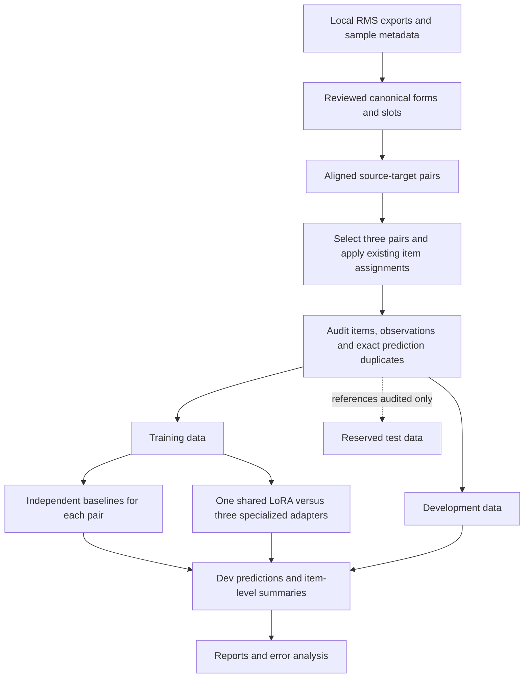

<div align="center">

# Romani Form Transduction

**Evaluating form transfer between non-standard Romani varieties.**

A research project on sample-to-sample form prediction, data exposure, and parameter-efficient adaptation for Romani varieties.

Language Technology MSc · Research & Development · Uppsala University  
**Andreia Alexa**

[Study design](#study-design) · [Pipeline](#pipeline) · [Quick start](#quick-start) · [Evaluation](#evaluation) · [Project status](#project-status)

</div>

---

> **Research in progress · Data snapshot: 28 October 2026**  
> Six RMS samples, three bidirectional pairs, and one item-level train/dev/test protocol. Baselines and a LoRA feasibility pilot are implemented. Production neural training and final-test evaluation are still pending.

## The task

Given a written form from one Romani sample, predict the corresponding form in another sample.

```text
Source sample     RO-059 · Romungro
Target sample     RO-072 · Romungro
Grammatical slot  1PL

Source form       amen putras
Target form       amen phutras
```

For the neural model, that example becomes:

```text
Input   <src=RO-059> <tgt=RO-072> <slot=1PL> amen putras
Output  amen phutras
```

This is an example from the prepared data for the elicitation item “open.” The English meaning and item ID help document alignment; **neither is a model input**. An unavailable grammatical slot is represented as `UNK`.

The project studies the selected **RMS samples**, rather than treating one speaker's form as a dialect-wide norm. Predictions are experimental outputs, not independently validated Romani forms.

## Why this project?

Small dialect datasets often reuse elicitation meanings, grammatical slots, and similar strings. Pair expansion can turn a few observations into many training rows. High scores can therefore reflect copying or lookup as well as learned correspondences.

This project asks:

- How do preparation, alignment, splitting, and permitted data exposure affect what the scores mean?
- How much can copying, exact-form reuse, and simple rewrite rules explain?
- Does one shared LoRA adapter perform differently from adapters specialized for the selected sample pairs?

The intended contribution is a small, auditable benchmark and an analysis of its behavior. Strong neural accuracy is a possible result, not a prerequisite for a useful study.

## Study design

### Six samples, three pairs

| Comparison | RMS samples | Interpretation |
|---|---|---|
| **Romungro** | `RO-059 ↔ RO-072` | Within the established Romungro grouping |
| **Kalderash** | `RO-008 ↔ RO-065` | Within the established Kalderash grouping |
| **Karamidari–Lingurari/Teglari** | `RO-025 ↔ RO-062` | Cross-variety comparison |

Only these **six directed mappings** are included. Karamidari and Lingurari/Teglari are paired for the experiment; they are not being declared one linguistic group.

### Shared versus specialized LoRA

| Condition | Training data |
|---|---|
| **One shared adapter** | All six selected training directions |
| **Three specialized adapters** | Each adapter receives its pair's two training directions |

Every fit starts independently from the same original pretrained `google/byt5-small` checkpoint. The backbone stays frozen; only LoRA parameters train. Specialized adapters do **not** start from the trained shared adapter.

ByT5 operates on UTF-8 bytes rather than a learned subword vocabulary. The current configuration uses LoRA rank **8**, alpha **16**, dropout **0.05**, and attention `q`/`v` projections. Source and target sample IDs determine specialized-adapter routing.

The combined specialized predictions must cover exactly the same evaluation rows as the shared model. Results are reported by pair and direction as well as in aggregate. Three specialists have more total adapter capacity than one shared adapter; this is a limitation to report.

**Active configurations:** [baselines](protocols/three_pair_baselines.json) · [LoRA pilot](protocols/three_pair_lora.json)  
**Detailed specification:** [CURRENT_EXPERIMENT.md](CURRENT_EXPERIMENT.md)

## Pipeline



The current experiment includes **lexemes and paradigm forms**, excluding rows marked `CHECK` on either side. Form type is used for selection and reporting, not as a predictive input.

Preparation retains raw exports and applies reviewed corrections in a separate layer. Imported annotations record source cells, review IDs, resulting forms, slots, and unresolved decisions. Stale source text stops the rebuild rather than silently applying an old correction.

### Current population

| Partition | Directed pair rows | Distinct elicitation items |
|---|---:|---:|
| Train | **4,097** | **256** |
| Development | **521** | **33** |
| Test | **526** | **32** |

Counts reflect the reviewed data as of 28 October 2026. They can change after further approved corrections. Items recur across pairs and slots, so **rows are not independent observations**.

### What the overlap checks enforce

All mappings for an item remain in the same partition. The audit checks train/dev, train/test, and dev/test for:

1. Shared item IDs.
2. Shared `(sample, item, slot)` observations, whether used as inputs or targets.
3. Identical prediction examples under different item IDs, including accepted target variants.

When training content duplicates a holdout example, the existing policy excludes the whole conflicting training item across the selected directions. A dev/test content conflict stops the run. **All three boundaries currently pass after exclusions.**

Shared substrings and productive patterns can still occur across partitions. This protocol tests held-out items; it does not establish unseen-lemma or unseen-transformation generalization. Test references are inspected for the structural audit, but the current runners do not produce final-test predictions or scores.

## Quick start

### Install

From the project root, for a first-time environment setup:

```bash
python3 -m venv .venv
.venv/bin/python -m pip install -r requirements.txt
```

For optional neural experiments:

```bash
.venv/bin/python -m pip install -r requirements-neural.txt
```

The preparation pipeline expects locally obtained RMS CSV exports and sample metadata. Raw exports and generated datasets are kept out of the code repository; this is not yet a released data package. Redistribution permissions must be established before publishing RMS-derived data.

### Run baselines

On macOS, double-click these files in the project folder:

| Launcher | Action |
|---|---|
| `validate_experiment.command` | Validate the final population and overlap checks |
| `run_baselines.command` | Run independent per-pair dev baselines and generate a report |
| `report_experiment.command` | Report the latest completed final-experiment baseline run |

Or use Terminal:

```bash
.venv/bin/python src/models/adapter_protocol.py \
  --config protocols/three_pair_baselines.json

.venv/bin/python src/baselines/compare_pairs.py \
  --experiment-config protocols/three_pair_baselines.json \
  --output reports/runs/three_pairs_dev_01
```

Use a **new output folder** for each run. The runner protects existing results.

### Inspect the neural plan

```bash
.venv/bin/python src/models/pilot_adapters.py \
  --config protocols/three_pair_lora.json \
  --dry-run --full-dev \
  --output reports/runs/three_pair_plan
```

This validates the selection and displays all four fits without training. The pilot also supports a local CPU smoke test and a representative CUDA timing run; see the [full command guide](docs/GROUP_LORA_GUIDE.md).

Neural loading uses the pinned checkpoint from the local cache by default. Downloads require explicit `--allow-download`. A CPU smoke test verifies correctness, not convergence or GPU feasibility. The planned production experiment has **four fits per seed and three seeds: 12 fits**; that full training schedule is not implemented yet.

## Evaluation

### Baselines

Baselines train **independently within each pair**. There is no pooled-baseline condition in the final workflow.

| System | What it measures |
|---|---|
| `copy_source` | Performance from leaving the source form unchanged |
| `source_form_lookup` | Exact input reuse: retrieve the most frequent training target, with copy backoff |
| `suffix_rule_with_backoff` | Restricted final-token rewriting with contextual backoff |
| `character_rewrite_pair` | Short substring transformations conditioned on sample pair, with backoff |

The exact-source lookup uses source sample, target sample, slot, and source string—not item IDs. Its coverage measures exact-form reuse across items. Suffix backoff still uses variety metadata; the character system retains fixed thresholds, unanchored edits, cascading, and row-based support counts. These are documented baseline limitations, not a completed contextual edit transducer.

### Main metrics

| Metric | Interpretation | Better |
|---|---|---|
| **Item-macro CER** | Average character error rate within each item, then average items equally | Lower |
| **Item-macro exact match** | Average exact-match outcomes within each item, then average items equally | Higher |
| **Row-mean CER** | Average row CER directly; items with more rows contribute more | Lower |
| **Lookup coverage** | Fraction of inputs found by the exact-source lookup | Diagnostic |

CER can exceed 1. Scoring uses the existing punctuation normalization and accepted target variants. Additional row-level diagnostics include normalized edit similarity and the current local chrF-style implementation. Summaries include each direction, each pair, and shared-item subsets. Item-level statistical utilities are available; they are not automatically run by the current baseline launcher.

### Outputs

```text
reports/
├── runs/<run>/
│   ├── config.json, split.json, data_audit.json, manifest.json
│   ├── dev_predictions.csv
│   ├── dev_summary.csv
│   └── report_<timestamp>.md
└── analysis/                         data-review and other diagnostics
```

This is the **baseline** layout. Neural pilot runs instead contain one directory per adapter, combined shared/individual predictions, and a `summary.json` with timing, memory, coverage, and save/reload checks.

## Project status

| Component | Status |
|---|---|
| Final sample/pair selection | Specified in the active configurations |
| Reviewed preparation and provenance | Implemented; annotation review continues |
| Item-level split and overlap audit | Implemented and passing |
| Independent baseline workflow | Implemented; dev runs available |
| Shared/specialized LoRA pilot | Implemented and CPU smoke-tested |
| Automated tests | **102 passing** at the latest verification |
| GPU timing and allocation | Pending |
| Production training and early stopping | Pending |
| Multi-seed neural results and final-test inference | Pending |

Three annotation cases remain pending (`S602`, `S604`, `S612`), alongside 35 records without decisions. The test set contains only 32 elicitation items, limiting the precision and breadth of final claims. Results remain provisional until preparation and evaluation choices are settled.

Earlier configurations, reports, and retired code are preserved for provenance. They are not the active experiment. Start with the files below rather than historical runner defaults.

## Project map

```text
protocols/                    Explicit experiment configurations
src/data/                     Normalization, review import, canonical forms, alignment
src/baselines/                Copy, lookup, rewriting, and per-pair runner
src/models/                   Audited data loading and LoRA feasibility pilot
src/evaluation/               Metrics, reports, and statistical utilities
scripts/                      Review import, token lengths, and GPU job helpers
tests/                        Active regression tests
docs/                         Guides, methodology, and review records
CURRENT_EXPERIMENT.md          Authoritative scope and population
PROPOSAL_REFINEMENT.md         Dated discussion and decision history
```

Some data, reports, documentation, and archive material are local research files and may not accompany a public code checkout.

**Read next:** [experiment specification](CURRENT_EXPERIMENT.md) · [commands](docs/GROUP_LORA_GUIDE.md) · [annotation review](docs/data_audit/paradigm_review_2026-10-27.md) · [approved corrections](docs/data_audit/approved_note_fixes_2026-10-28.md)

### Tests

```bash
.venv/bin/python -m pytest tests/ -q
```

Use the active `tests/` directory; archived tests describe superseded workflows.

## References

- [Romani Morpho-Syntax Database and dialect resources](https://www.kratylos.org/~raphael/romani/db/index.html), Manchester Romani Project.
- Xue et al. (2022). [ByT5: Towards a Token-Free Future with Pre-trained Byte-to-Byte Models](https://aclanthology.org/2022.tacl-1.17/).
- Hu et al. (2021). [LoRA: Low-Rank Adaptation of Large Language Models](https://arxiv.org/abs/2106.09685).
- Popović (2015). [chrF: Character n-gram F-score for Automatic MT Evaluation](https://aclanthology.org/W15-3049/).

---

*An R&D project on what small dialect datasets let us learn—and how to evaluate that evidence carefully.*
